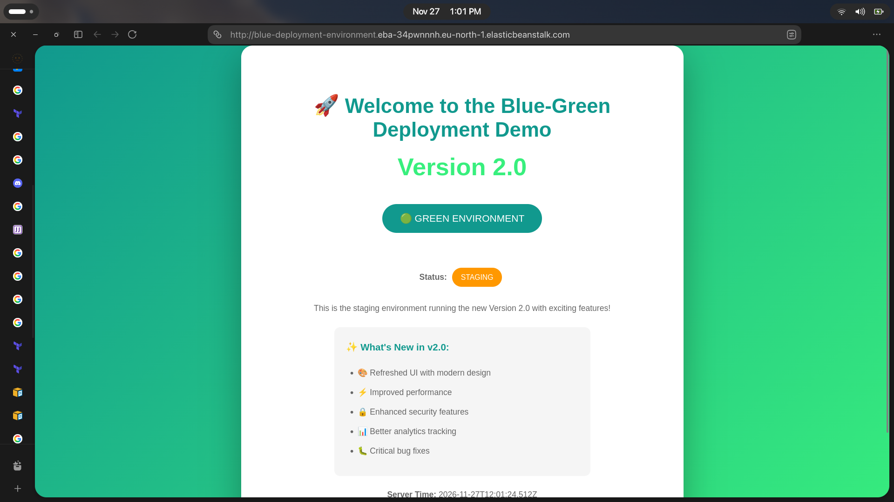

# Blue-Green Deployment on AWS Elastic Beanstalk with Terraform

This project provisions a Blue-Green deployment setup for a Node.js Express application (`src/app-v1` and `src/app-v2`) on AWS Elastic Beanstalk in `eu-north-1` using Terraform, paired with a Bash script (`swap-cname.sh`) to swap environment CNAMEs.

## What Was Built



- Shared VPC (`10.0.0.0/16`), two public subnets across availability zones, an Internet Gateway, and route table associations
- Shared IAM roles and policies for Elastic Beanstalk service health (`beanstalk_service` with `AWSElasticBeanstalkEnhancedHealth`) and EC2 instances (`beanstalk_ec2_role` + `beanstalk_ec2_profile` with `AWSElasticBeanstalkWebTier`)
- Local artifact packaging via `terraform_data` (`local-exec` zipping `src/app-v1` and `src/app-v2` while excluding `node_modules`, `.git`, and `.env*`), uploaded to S3 (`elasticbeanstalk-artifacts-uniq`) and registered as Elastic Beanstalk application versions (`app-v1`, `app-v2`)
- Two Elastic Beanstalk environments (`blue-deployment-environment` running `app-v1` and `green-deployment-environment` running `app-v2`) on `64bit Amazon Linux 2023 v6.12.4 running Node.js 26` with `PORT=8080`, `/health` checks, enhanced health reporting, and CPU auto-scaling (`1` to `3` instances)
- Companion ALB, target group, and security group resources per environment alongside remote Terraform state in S3 (`my-terraform-state-bucket-uniq`) with encryption and lockfile support
- A Bash script (`swap-cname.sh`) that invokes `aws elasticbeanstalk swap-environment-cnames` and polls `describe-environments` until both environments return to `Ready`

## How It Works


Terraform builds local `.zip` bundles from `../src/app-v1` and `../src/app-v2` inside `infra/`, uploads them to S3 (`aws_s3_object`), registers `app-v1` and `app-v2` on `Blue-Green-Deployment-Application`, and deploys each version to its respective Elastic Beanstalk environment. Each Express app listens on `PORT` (`8080` by default) and exposes `/health`, `/`, and `/api/info` (plus `/api/features` in v2.0). Once both environments are healthy, `swap-cname.sh` swaps their CNAME records and waits for `Ready` status.

```mermaid
flowchart LR
    V1["src/app-v1<br/>(Express v1.0, :8080)"]
    V2["src/app-v2<br/>(Express v2.0, :8080)"]
    Zip["terraform_data<br/>app_v1_zip / app_v2_zip"]
    S3Artifacts[("S3 Artifacts Bucket<br/>elasticbeanstalk-artifacts-uniq")]
    App["aws_elastic_beanstalk_application<br/>Blue-Green-Deployment-Application"]
    Blue["aws_elastic_beanstalk_environment<br/>blue-deployment-environment (app-v1)"]
    Green["aws_elastic_beanstalk_environment<br/>green-deployment-environment (app-v2)"]
    Swap["swap-cname.sh<br/>swap-environment-cnames"]
    State[("S3 State Backend<br/>my-terraform-state-bucket-uniq<br/>(Encrypted + Lockfile)")]

    V1 --> Zip
    V2 --> Zip
    Zip --> S3Artifacts
    S3Artifacts --> App
    App --> Blue
    App --> Green
    Swap -.->|"Swaps CNAMEs"| Blue
    Swap -.->|"Swaps CNAMEs"| Green
    Blue -.->|"Terraform State"| State
    Green -.->|"Terraform State"| State
